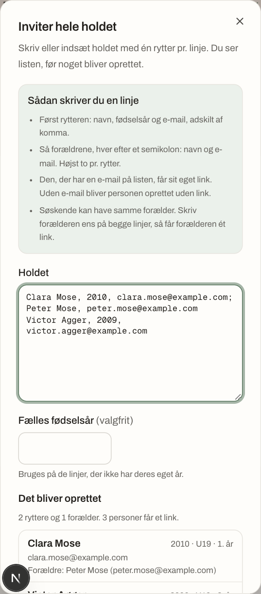
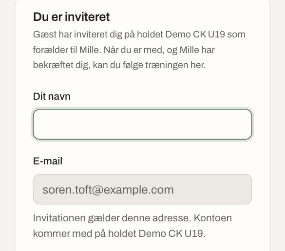
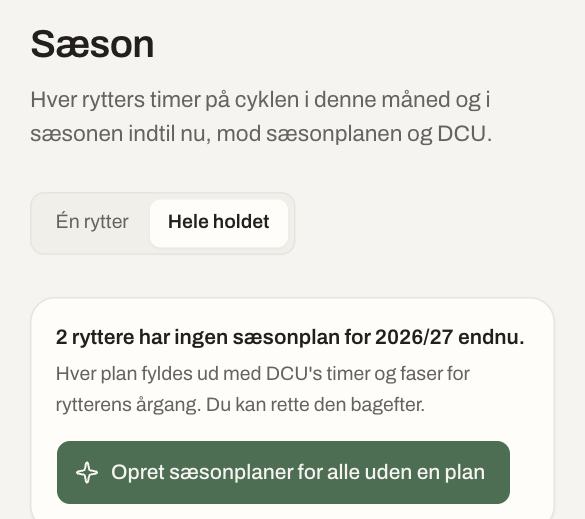
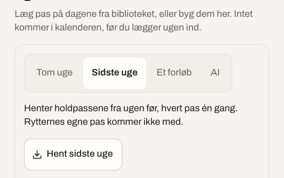
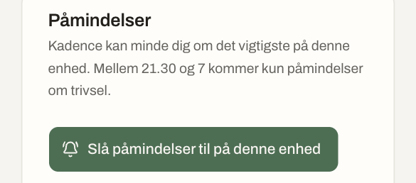
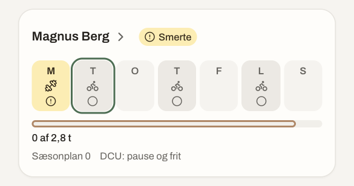
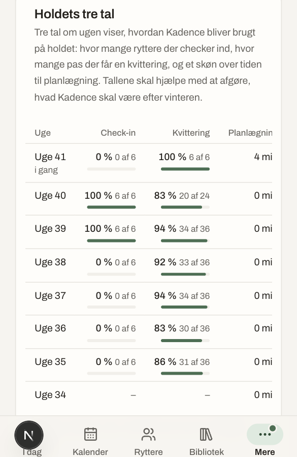
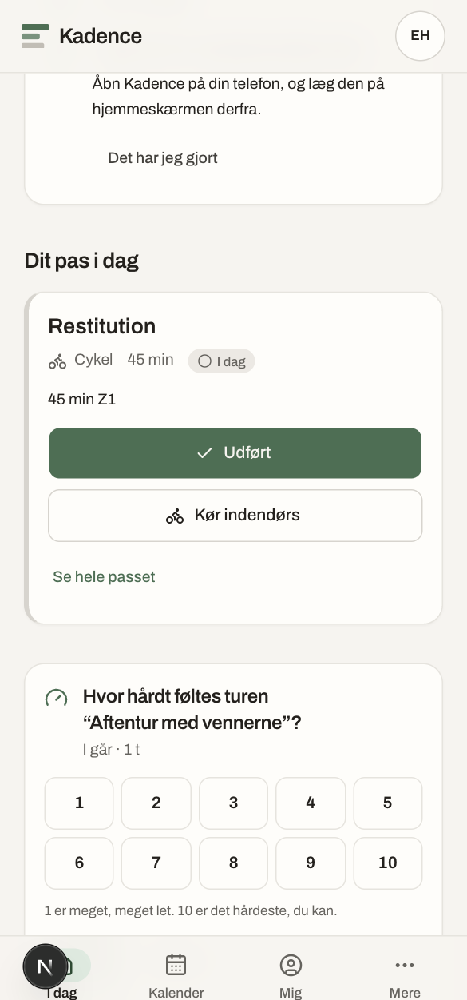

# Pilotguide: de første to uger

Denne guide er til dig, der er træner for pilotholdet. Den tager dig
gennem de to første uger, trin for trin, med det Kadence faktisk kan i
dag. Læs den i ro og mag — det tager ti minutter. Du behøver ikke gøre
alting med det samme; hvert afsnit står for sig selv, og du kan altid
komme tilbage til det.

## Dag 1: holdet er oprettet

Dit hold findes på to måder. Enten har du selv oprettet en konto på
`/register` — konto og hold bliver til samtidig, og du bliver holdets
ejer — eller Martin har oprettet holdet og sendt dig et link, hvor du
opretter din konto som træner på det. Begge veje lander du det samme
sted: som træner på jeres eget hold i Kadence.

Næste skridt er at få resten af holdet med. På **Ryttere** står knappen
**"Inviter hele holdet"** ved siden af "Tilføj rytter". Skriv eller
indsæt listen med én rytter pr. linje: navn, fødselsår og e-mail,
adskilt af komma. Har en rytter forældre med, skriver du dem efter et
semikolon, hver med navn og e-mail. Søskende kan dele en forælder —
skriv forælderen ens på begge linjer, så får de ét link i stedet for to.
Du ser, hvad der bliver oprettet, før du trykker opret.

Bagefter får du en liste med alle, der har fået et link, og en
**"Del"**-knap ved hver: på telefonen åbner den delingsmenuen (sms,
chat), ellers kopierer den teksten, så du selv kan sætte den ind. Et
link kræver en e-mailadresse og virker i en uge; mangler adressen,
oprettes personen uden link, og du inviterer dem senere fra rytterens
side. Er der nogen, der ikke har åbnet linket endnu et par dage efter,
finder du dem under **"Links, der venter"** på samme side og kan dele
igen.

Når en rytter eller forælder åbner linket, ser de med det samme, hvad de
er inviteret som: "… som rytter" eller "… som forælder til Emma", og
hvad der skal ske. En forælders adgang låses først op, når rytteren selv
har sagt ja til forælderen under sine egne indstillinger — det nævner
siden også.

## Dag 1–2: sæsonplaner for alle

Når ryttere og forældre er inviteret, kan du lægge sæsonen for hele
holdet på én gang. Gå til **Sæson → Hele holdet**. Der står, hvor mange
ryttere der endnu ikke har en sæsonplan, og en knap: **"Opret
sæsonplaner for alle uden en plan"**. Den laver en plan pr. rytter ud
fra DCU's timer og faser for deres klasse og årgang — en rytter, der
allerede har en plan, bliver ikke rørt. I kan rette alt bagefter, både
for hele holdet og for den enkelte.

Oktober er DCU's pause- og frimåned, så sæsonplanen viser ingen ramme
for timer i oktober — det er ikke en fejl, bare DCU's egen kalender.
Rammen begynder for alvor fra november.

## Uge 1: læg ugen ind

Al planlægning sker ét sted: **Planlæg ugen**, som du åbner fra Kalender
eller fra en rytters egen uge. Vælg hvem ugen er for — hele holdet, en
årgang eller enkelte ryttere — og vælg, hvor ugen skal starte fra: en
**tom uge**, **sidste uge** (holdets pas fra ugen før, hver for sig),
**et forløb** fra biblioteket, eller **AI**, som foreslår en uge ud fra
holdets bibliotek. Du ser altid, hvad ugen giver mod sæsonplanen, før du
lægger den ind, og intet rammer kalenderen, før du selv trykker.

Et pas kan have et tidspunkt og et mødested, fx "17.30 · Klubhuset" —
praktisk for den faste tirsdagstræning eller lørdagsturen fra
klubhuset. Det står på kortene i kalenderen, på rytterens og forældrenes
"I dag", og det tager du med, når du trykker **"Del ugen"** på holdets
uge: en tekst med ugens pas, tider og steder, klar til at sætte ind i
klubbens sms- eller chatgruppe. Teksten siger intet om, hvordan nogen
har det eller har kørt. Skal en uge gentages, vælger du under "Læg ugen
ind i", hvor mange uger i træk den samme uge skal ligge; en god uge kan
også gemmes som forløb til senere med "Gem som forløb".

Har holdet trænet hårdt sammen, kan du give ryttere et mobilitetsprogram
med tegninger fra **Bibliotek → Øvelser og programmer** og lægge det i
kalenderen som et pas.

Brug også dagen til at slå dine egne påmindelser til. Under
**Indstillinger → Mig → Påmindelser** trykker du "Slå påmindelser til på
denne enhed". Som træner kan du vælge **"Trivsel"**: én push samme dag
en rytter checker ind i rød zone, uden navn, med link til
opmærksomhedspunkterne. Når påmindelser er slået til, kan du trykke
**"Send en prøve"** og se med det samme, om den kommer frem på din
telefon — linjen under viser status: tilladelse, om der er en service
worker, og om der er et abonnement. På en iPhone virker påmindelser
først, når Kadence er lagt på hjemmeskærmen (det siger siden også).
Fortæl gerne ryttere og forældre, at de kan gøre det samme på deres
egne telefoner.

## Hver uge: Holdets uge og pilotens tre tal

**Kalender → Hele holdet** er det, du lander på, når du åbner kalenderen
som træner. På telefonen er det et kort pr. rytter: ugens dage som
chips, og et lille mærke under navnet, hvis der er noget værd at se på —
fx "Smerte". Mærket er ét ord; tryk på rytterens navn eller "Se ugen"
for at komme til ugen og forklaringen. Nedenfor kortene står hele
listen med opmærksomhedspunkter, og I kan markere et punkt "Afklaret",
når I har talt om det. Punkterne følger kun ugen, der er i gang — en
gammel eller kommende uge viser ingen.

Resten af billedet kommer fra ryttere, der checker ind hver morgen, og
fra "Udført" (eller en tur, der lander af sig selv) efter en træning.
Det er netop det, der tælles op under **Indstillinger → Holdet →
"Holdets tre tal"**: hvor stor en andel af ryttere, der har checket ind
mindst fire dage om ugen, hvor stor en andel af passene der har fået en
kvittering, og et groft skøn over, hvor mange minutter du har brugt på
at planlægge, regnet ud fra, hvornår du har gemt pas, blokke og
sæsonplaner. De sidste otte uger står samlet, med ugen i gang først.

De tre tal er ikke en bedømmelse af dig eller nogen enkelt uge — de er
til at se et mønster hen over vinteren. "Brugt i virkeligheden. Intet af
det vi selv har bygget kommer i vinduet før det har kørt rigtigt
arbejde, hos os selv eller hos en kunde vi sidder tæt på." (dogme syv,
`README.md`). Det er lige præcis, hvad jeres vinter med Kadence er med
til at afgøre.

## Hvad rytterne møder

Første gang en rytter åbner Kadence, møder de **"Kom i gang"** øverst på
I dag: hvad de kører med (Garmin, Wahoo, Polar, kun Strava eller ingen
cykelcomputer), deres tærskler (eller "spring over", så bruger Kadence i
stedet, hvor hårdt det føltes), og at lægge Kadence på hjemmeskærmen;
venter der en forælder på at blive bekræftet, står det trin også med.
Resten af I dag er kort: dagens pas med
"Udført" og "Kør indendørs", dagens check-in, og i morgen. Har den
seneste tur ingen vurdering endnu, spørger siden "Hvor hårdt føltes
turen …?" med en skala fra 1 til 10.

Alt det, der ikke er i dag — formen som en kurve med ord, de seneste 14
dages check-ins, mål og rekorder, og upload — ligger samlet på
**Mig**. En forælder lander på én side om deres barn: ugen, formen, og
hvis rytteren deler det, hvordan det går. De ser intet, før rytteren har
sagt ja til dem; siden har også Forældreguiden, Team Danmarks og Kolding
Talents råd i kort form.

## Hvem du kan spørge

Har du spørgsmål undervejs, kan du altid spørge Martin:
`[Martins telefonnummer eller e-mail — indsættes af Martin]`.

Går noget i stykker, eller virker noget ikke, som det skal: siden
**Hjælp** i Kadence beskriver, hvordan tingene er tænkt, og du finder
den i menuen under "Mere". Skriv ellers til Martin og fortæl, hvad der
skete — intet går tabt undervejs, jeres data og plan står, som de stod,
mens det bliver rettet.
